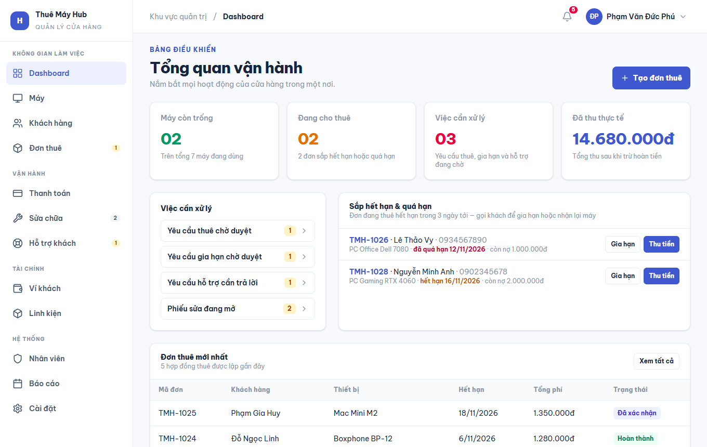

# Thuê Máy Hub

Ứng dụng quản lý cửa hàng cho thuê **PC** và **Boxphone**: máy, khách hàng, đơn thuê, thu tiền,
ví khách, sửa chữa, linh kiện, hỗ trợ khách và báo cáo. Có ba vai trò dùng chung một màn đăng nhập:
**chủ cửa hàng**, **nhân viên** và **khách hàng**.

Đồ án môn **SEP** — Nhóm 11, CTIN.



## Tính năng chính

| Vai trò | Làm được gì |
| --- | --- |
| Chủ cửa hàng | Toàn quyền. Duyệt yêu cầu thuê và gia hạn, thu tiền, hoàn tiền, nạp ví, xác nhận khách nạp ví qua chuyển khoản, quản lý máy, linh kiện, nhân viên. Xem báo cáo doanh thu. Cài đặt cửa hàng, tài khoản nhận chuyển khoản, khoá mạng khi hết hạn, sao lưu, nhắc hạn qua Telegram. Xem nhật ký thao tác. |
| Nhân viên | Việc ở quầy: tạo đơn, giao và nhận máy, thu tiền, sửa chữa, trả lời hỗ trợ khách. Không thấy số liệu tiền của cả tiệm, không hoàn tiền, không nạp ví. |
| Khách hàng | Xem máy trống, gửi yêu cầu thuê kèm số Zalo hoặc điện thoại và cách nhận máy (UltraViewer, TeamViewer…). Trả tiền đơn bằng ví, xin gia hạn. Nạp ví bằng **mã VietQR**. Nhắn tin hỗ trợ hai chiều theo thời gian thực. |

Quyền được kiểm ở server ([server/permissions.ts](server/permissions.ts)), không chỉ ẩn nút ở giao diện.

## Cấu trúc thư mục

```
.
├── server/                 Backend: Express 5 + SQLite (node:sqlite)
│   ├── index.ts            Điểm vào, API máy / khách / đơn / tiền / sửa chữa / cài đặt
│   ├── database.ts         Lược đồ dữ liệu, migration cột mới, hàm dùng chung
│   ├── permissions.ts      Phân quyền chủ / nhân viên
│   ├── hub.ts              Đăng nhập chung ba vai trò, hồ sơ khách, ví, thông tin cửa hàng
│   ├── customer.ts         Cổng khách (yêu cầu thuê, gia hạn, hỗ trợ) và quầy dịch vụ
│   ├── topup.ts            Nạp ví qua chuyển khoản VietQR
│   ├── network-lock.ts     Khoá mạng máy quá hạn
│   ├── backup.ts           Sao lưu theo lịch
│   └── seed-hub.ts         Dữ liệu mẫu cho bản demo
│
├── ThueMayHub-FE/          Giao diện chính: React 19 + TanStack Start + Tailwind CSS 4
│   └── src/
│       ├── lib/            Kho dữ liệu (zustand) và lời gọi API
│       └── components/     auth/, admin/ (các trang quản trị), customer/ (cổng khách), support/, ui/
│
├── src/, electron/         Giao diện đời đầu và vỏ ứng dụng desktop (Electron)
│
├── scripts/                Công cụ dòng lệnh
│   ├── hub.mjs             Chạy app (npm run hub / hub:start)
│   ├── hub-flow-test.mjs   Kiểm thử luồng nghiệp vụ qua API
│   ├── hub-ui-test.mjs     Kiểm thử giao diện bằng trình duyệt (Playwright)
│   ├── *-test.mjs, *.ps1   Kiểm thử từng mảng: tiền, gia hạn, sao lưu, phân quyền, khoá mạng…
│   ├── pack-tester.mjs     Đóng gói bản demo chạy ngay cho tester (kèm node.exe)
│   ├── tester-kit/         Hướng dẫn và file .bat đi kèm gói tester
│   └── sep/                Sinh hồ sơ SEP (Word/PDF/Excel, sơ đồ UML, CSV Jira)
│
├── HUONG-DAN/              Hướng dẫn cài đặt, vận hành, kiến trúc, triển khai
├── design/                 Sơ đồ lớp, sơ đồ UML, ảnh chụp giao diện
└── SEP_Nhom11_ThueMayHub/  Hồ sơ đồ án: quản lý dự án, yêu cầu, thiết kế, kiểm thử, báo cáo
```

## Chạy thử

Cần **Node.js 22** trở lên, vì backend dùng `node:sqlite` có sẵn trong Node 22.

```bash
npm install
npm run hub
```

Mở http://localhost:5274. Lần chạy đầu, lệnh này tự cài thư viện cho `ThueMayHub-FE/` và tạo dữ liệu mẫu trong
`data/hub-demo.db`. API chạy ở cổng 8789. Sửa code bên nào thì bên đó tự tải lại.

Tài khoản mẫu, mật khẩu đều là `demo123`:

| Vai trò | Tài khoản |
| --- | --- |
| Chủ cửa hàng | `admin` |
| Nhân viên | `phat`, `thanh`, `vinh`, `anh` |
| Khách hàng | `0902345678` hoặc `minhanh@email.com` |

Các lệnh khác:

| Lệnh | Việc |
| --- | --- |
| `npm run hub:start` | Build giao diện rồi chạy một cổng 8789 phục vụ cả API lẫn giao diện |
| `npm run hub:reset` | Xoá dữ liệu, tạo lại dữ liệu mẫu |
| `npm run hub:pack` | Tạo `release/tester/ThueMayHub-Demo-Tester.zip`: giải nén, bấm `CHAY-DEMO.bat` là chạy, không cần cài gì |
| `npm run supabase:push` | Đưa cấu trúc database và dữ liệu mẫu lên Supabase (PostgreSQL) để trình bày, xem mục [Database trên Supabase](#database-trên-supabase) |
| `npm run sep:baocao` | Sinh lại báo cáo tiến độ và báo cáo hoàn chỉnh (Word + PDF, cần Microsoft Word) |

## Kiểm thử

Chạy khi `npm run hub` đang chạy:

```bash
npm run test:hub      # 93 kiểm tra luồng nghiệp vụ qua API
npm run test:hub-ui   # đi hết các màn hình bằng trình duyệt Edge, chụp ảnh vào ThueMayHub-FE/test-results/
```

Hai bài này ghi thêm dữ liệu vào `data/hub-demo.db`; chạy xong thì `npm run hub:reset` để về dữ liệu mẫu.
Các bài kiểm thử riêng từng mảng (`test:finance`, `test:renew`, `test:backup`, `test:perm`…) có trong
[package.json](package.json).

## Nạp ví qua VietQR

1. Chủ cửa hàng vào **Cài đặt → Nhận chuyển khoản**, chọn ngân hàng, nhập số tài khoản và tên chủ tài khoản.
2. Khách vào **Ví tiền**, chọn số tiền và nhận mã QR. App ngân hàng nào ở Việt Nam cũng quét được mã này, vì nó đã điền sẵn số tiền và nội dung riêng dạng `NAP XXXXXX`.
3. Khách chuyển khoản xong thì bấm **Tôi đã chuyển khoản**. Chủ nhận được thông báo.
4. Chủ đối chiếu sao kê theo nội dung chuyển khoản rồi bấm **Đã nhận tiền**. Lúc đó tiền mới vào ví khách.

Mã QR được tạo ngay trên server theo chuẩn EMVCo/NAPAS, không gọi dịch vụ bên ngoài
([server/topup.ts](server/topup.ts)).

## Tài liệu

- [HUONG-DAN/](HUONG-DAN/README.md): bắt đầu, vận hành hằng ngày, kiến trúc và nguyên tắc sổ tiền, ứng dụng desktop, triển khai VPS.
- [ThueMayHub-FE/README.md](ThueMayHub-FE/README.md) và [ThueMayHub-FE/BACKEND.md](ThueMayHub-FE/BACKEND.md): giao diện và cách nó nối với backend.
- [SEP_Nhom11_ThueMayHub/](SEP_Nhom11_ThueMayHub/00_GIOI_THIEU.md): hồ sơ đồ án theo 4 phần (quản lý dự án, yêu cầu, kiến trúc và thiết kế, kiểm thử), kèm báo cáo tiến độ và báo cáo hoàn chỉnh.
- [design/](design/): sơ đồ lớp, sơ đồ UML, ảnh chụp từng màn hình.

## Dữ liệu

Repo **không** chứa database nào. Thư mục `data/` bị loại khỏi git. App tự tạo database và dữ liệu mẫu khi chạy lần đầu.
Mọi tên khách, số điện thoại trong dữ liệu mẫu đều là giả.

## Database trên Supabase

App chạy bằng SQLite. Để trình bày thiết kế database trên cloud, lệnh `npm run supabase:push` chép
cấu trúc và dữ liệu mẫu sang một project Supabase (PostgreSQL):

1. Chép `.env.example` thành `.env`, điền `DATABASE_URL` bằng chuỗi **Session pooler** lấy ở nút
   **Connect** của project. File `.env` không lên git.
2. Chạy `npm run supabase:push`. Script tạo dữ liệu mẫu mới, dịch sang PostgreSQL (tiền thành `BIGINT`,
   thời điểm thành `TIMESTAMPTZ`, giữ khoá ngoại, `CHECK`, chỉ mục), đẩy lên rồi đếm lại từng bảng.
3. Xem trong Supabase: **Table Editor** để xem bảng và dữ liệu, **Database → Schema Visualizer** để xem sơ đồ quan hệ.

Không muốn đưa mật khẩu database vào máy thì chạy `npm run supabase:push -- --sql`, rồi dán file
`release/supabase/thue-may-hub.sql` vào **SQL Editor** của Supabase và bấm Run.

Chạy lại bao nhiêu lần cũng được: chỉ các bảng của app bị làm lại từ đầu, bảng khác giữ nguyên.
Mọi bảng đều bật Row Level Security mà không có policy, nên API công khai của Supabase không đọc được
dữ liệu. Script luôn dùng dữ liệu mẫu tạo mới, không bao giờ đọc database đang chạy.
